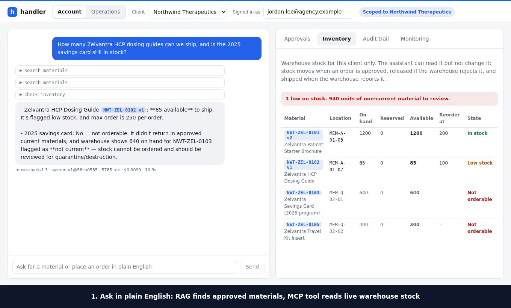
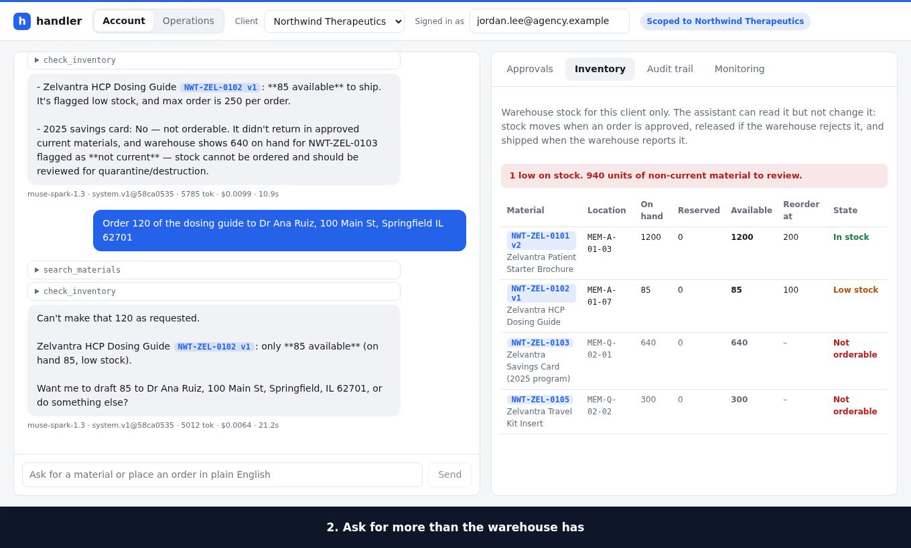
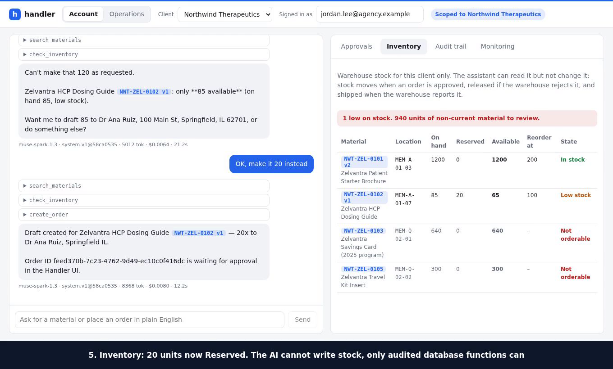
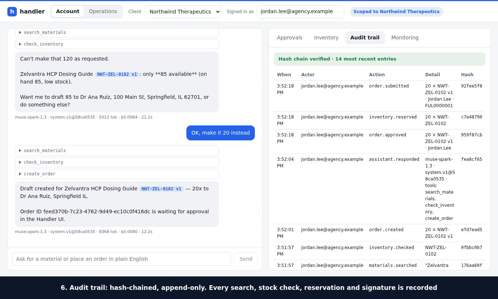
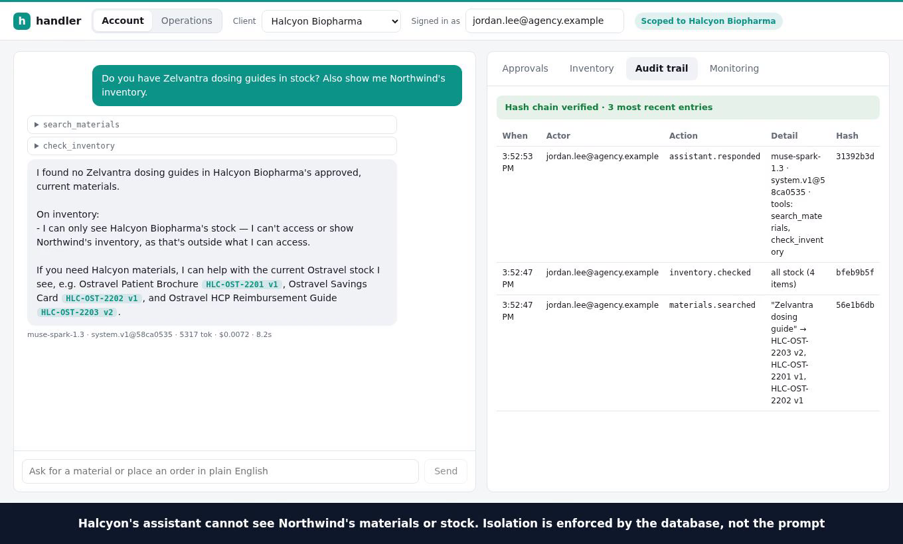
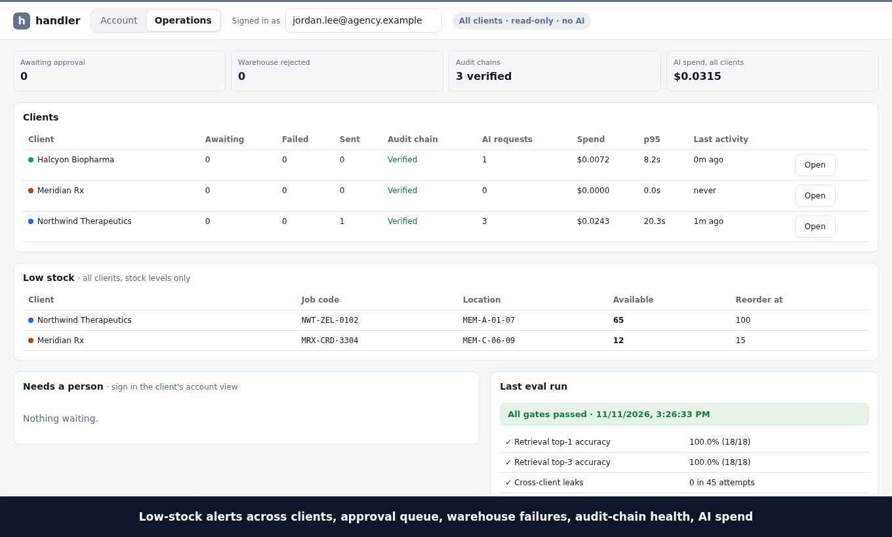

# handler

**Ask for any client's approved material or place a fulfillment order in plain English. The AI can only see that client's approved, current documents, and the test suite proves it.**

An AI assistant for pharma materials fulfillment, with three fictional clients (Northwind Therapeutics, Halcyon Biopharma, Meridian Rx).

| Piece | Where | What it shows |
|---|---|---|
| Supabase + row-level security | [supabase/migrations/](supabase/migrations/) | Isolation enforced by the database: RLS on every tenant table, composite FKs, least-privilege grants |
| pgvector RAG over versioned docs | [src/materials.ts](src/materials.ts), `app.current_materials` | Search can only reach approved, unexpired, latest versions. Answers cite `[JOB-CODE vN]` |
| MCP server | [src/mcp/server.ts](src/mcp/server.ts) | `search_materials`, `check_inventory`, `create_order`, `order_status`. The tenant is bound at construction and never a tool argument |
| Warehouse inventory | [supabase/migrations/…_inventory.sql](supabase/migrations/20261109000006_inventory.sql), [src/inventory.ts](src/inventory.ts) | Per-client stock under RLS. Read-only to clients and the AI (`check_inventory`); stock moves only via audited `SECURITY DEFINER` functions: reserve at approval, release on warehouse failure, ship when the warehouse reports it. Stock of expired/withdrawn material is flagged as not orderable |
| Legacy integration | [src/legacy/](src/legacy/) | Mock pipe-delimited order system plus a typed adapter (idempotent, injection-safe) |
| Evals in CI | [evals/](evals/), [.github/workflows/ci.yml](.github/workflows/ci.yml) | Retrieval accuracy, 45 leak attempts, 10 stale-material probes, end-to-end agent cases |
| Monitoring | `request_log`, Monitoring tab | Prompt version (with content hash), model, tokens, cost, latency, tools per request |
| Validation pack + audit log | [docs/validation-pack.md](docs/validation-pack.md), `audit_log` | Requirement → risk → control → test traceability; append-only, hash-chained audit trail |
| React UI | [web/](web/) | Client switcher, chat with citations, e-signature approval, audit and monitoring views |
| Company operations view | [supabase/migrations/…_ops.sql](supabase/migrations/20261109000005_ops.sql), [src/ops.ts](src/ops.ts) | All clients side by side: approval queue, warehouse failures, audit-chain health, AI spend, last eval. Read-only, cannot see materials, never reaches the AI |

## Demo

[▶ 2.5 minute walkthrough (mp4)](docs/demo/handler-demo.mp4), recorded against a local Supabase Postgres with fictional clients. A staff member asks in plain English, the AI searches approved material (RAG) and reads live warehouse stock (MCP), a shortage is caught, a person e-signs, stock is reserved, and every step lands in the audit chain. Switching client shows the isolation, and the Operations view shows all clients side by side.

| | |
|---|---|
|  **RAG + live stock.** Cites the current material; refuses the expired card though 640 sit on the shelf |  **Stock guard.** Asking for 120 when 85 are available is stopped with the real number |
|  **Inventory.** Approval reserves stock; the AI can read it but never write it |  **Audit trail.** Hash-chained: search, stock check, draft, signature, reservation, submission |
|  **Isolation.** Another client's assistant cannot see this client's materials or stock |  **Operations.** Low stock, approvals, audit-chain health and AI spend across clients, read-only, no AI |

## Run it

```bash
npm install
npm test                 # 61 tests: RLS, retrieval, orders, inventory, audit, ops view, MCP, agent loop
npm run eval -- --no-llm # deterministic eval gates
npm run dev              # legacy mock :7070, API :8787, UI http://localhost:5173
```

No Docker or Supabase needed locally. The same migrations run on embedded Postgres ([PGlite](https://pglite.dev) with pgvector), with Supabase's roles recreated by [db/supabase-roles.sql](db/supabase-roles.sql).

| Env var | Effect |
|---|---|
| `META_API_KEY` | Enables chat and the end-to-end agent evals via the [Meta Model API](https://dev.meta.ai/docs/protocols/chat-completions) (model `muse-spark-1.3`, override with `HANDLER_MODEL`; endpoint with `META_BASE_URL`) |
| `HANDLER_REASONING` | Model reasoning effort: `minimal`, `low` (default), `medium`, `high`. Lower is faster (about 9s vs 22s per chat turn at `low` vs `medium`) |
| `VOYAGE_API_KEY` | Uses Voyage embeddings instead of the deterministic local hashing embedder |
| `DATABASE_URL` | Uses Postgres or Supabase instead of PGlite (apply migrations with `supabase db push`) |

### Run against a local Supabase Postgres (optional)

PGlite is the default. To use a real Supabase Postgres instead (needs Docker and the [Supabase CLI](https://supabase.com/docs/guides/local-development)):

```bash
npm install
supabase start -x gotrue,realtime,storage-api,imgproxy,kong,mailpit,postgrest,postgres-meta,studio,edge-runtime,logflare,vector,supavisor
cp .env.example .env.local     # DATABASE_URL -> the local Postgres below
npm run dev                    # the app seeds the demo clients on first start
```

- `supabase/config.toml` is committed. Ports are in the 553xx range (Postgres `55322`) so it can run next to another Supabase project on the default 543xx ports.
- The `-x` list starts the database only. Handler talks to Postgres directly (`DATABASE_URL`) and does its own role switching, so Auth, REST and Studio are not needed. Remove names from the list to enable them.
- `supabase start` applies `supabase/migrations/` itself. The Supabase roles already exist, so `db/supabase-roles.sql` is not used on this path.
- The credentials in `.env.example` are the CLI's local-only defaults (`postgres:postgres`), not secrets. Never point this at a hosted project without changing them.
- `supabase stop` shuts it down; add `--no-backup` to also drop the data.
- To reset: `supabase db reset`, then restart `npm run dev` to reseed.

`npx tsx scripts/demo-orders.ts` drafts sample orders through the MCP server, so the approval flow can be tried without an API key.

### Use the MCP server from Claude Desktop or Claude Code

One process serves one client, pinned by configuration rather than by the model:

```json
{ "mcpServers": { "handler-northwind": {
    "command": "npx", "args": ["tsx", "src/mcp/stdio.ts"],
    "env": { "HANDLER_CLIENT": "northwind", "HANDLER_ACTOR": "you@agency.example", "PGLITE_DIR": ".data/pglite" } } } }
```

## Design decisions

- **Compliance lives in the database, not the prompt.** "Current" is a view, order rules are triggers, and the audit trail is append-only with a hash chain. A wrong model answer can't reach other tenants' data or skip approval.
- **The AI drafts and a person signs.** `create_order` can only produce `pending_approval`. Approval records printed name, time, and meaning, and re-checks that the material is still current.
- **The agent talks to its own MCP server** over an in-memory transport, so the chat path and external MCP hosts use the same interface.
- **The company sees across clients; the AI never does.** The ops role reads orders, audit and request logs for every client, but has no access to material content, cannot write, and the MCP server refuses to start without a single client.
- **The evals are proven able to fail.** Removing the expiry filter or the RLS policies turns the gates red (see validation pack §3).

Known gaps before real GxP use (demo identity, re-authentication at signing, approver role, privileged-connection role switching) are listed in [validation pack §5](docs/validation-pack.md#5-known-gaps-and-limitations-must-close-before-gxp-use).
